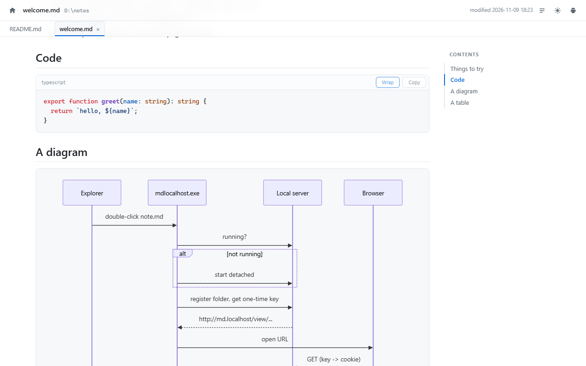

# md.localhost

Double-click a `.md` file in Windows Explorer and it opens, rendered, at
`http://md.localhost/`. Double-click another and it arrives as a **tab inside
the viewer you already have open** rather than as one more browser tab.



It installs as a desktop application, so it can live on the taskbar with its
own icon and window rather than inside a browser.

A single ~12 MB executable with no runtime dependencies. It registers itself as
a handler for Markdown files; the first double-click starts a small loopback
server in the background, every one after that reuses it, and the server shuts
itself down about half an hour after you close the last tab.

## Install

1. Build `mdlocalhost.exe` (needs [Go](https://go.dev/dl/) 1.22+):

   ```powershell
   powershell -ExecutionPolicy Bypass -File .\build.ps1
   ```

2. Register it:

   ```powershell
   powershell -ExecutionPolicy Bypass -File .\install.ps1 -StartMenu
   ```

3. Double-click any `.md` file.

Everything is written under `HKEY_CURRENT_USER` and `%LOCALAPPDATA%`, so no
administrator rights are needed.

### If Windows still opens your old editor

Windows 10 and 11 deliberately stop programs from changing the *default* app
for a file type — that setting is protected by a signed `UserChoice` registry
key. If `.md` was already claimed by something else, `install.ps1` will say so
and you finish by hand, once:

> right-click a `.md` file → **Open with** → **Choose another app** →
> **md.localhost** → tick **Always use this app**

### Uninstall

```powershell
powershell -ExecutionPolicy Bypass -File .\uninstall.ps1
```

## What it renders

- **GitHub-flavored Markdown** — tables, task lists, strikethrough, autolinks,
  footnotes, definition lists, `:emoji:`, and smart punctuation.
- **Code blocks with their own toolbar** — the language on the left, `Wrap` and
  `Copy` on the right. Long lines wrap by default so nothing hides behind a
  horizontal scrollbar; `Wrap` turns that off for the whole document and
  remembers the choice. Soft wrapping adds no characters, so selecting a block
  by hand copies exactly what is in the file.
- **Syntax highlighting** for fenced blocks that name their language. A block
  that names none is left as plain text on purpose: asked to guess,
  highlight.js confidently scores things like Jira wiki markup as `vbnet` or
  `swift` and paints prose in keyword colours.
- **Jira wiki markup preview.** A block holding Jira markup — a ` ```jira `
  fence, or an unlabelled block containing `h3.`, `||tables||`, `{{monospace}}`,
  `[~accountid:…]`, `{code}`, `bq.` and friends — is drawn the way Jira will
  draw it: headings, `*bold*`, lists, tables, panels, mentions and links.
  `Preview` in the block's toolbar swaps between the rendering and the raw
  markup, and `Copy` always returns the raw text either way. Detection needs one
  of those unambiguous constructs, so ordinary prose is never mistaken for
  markup. Run the renderer's tests with `node tests/jira.test.js`.
- **Mermaid diagrams** from ` ```mermaid ` blocks, re-themed when you switch
  between light and dark.
- **Dark mode**, following the Windows setting by default. The button in the
  top-right cycles auto → light → dark and remembers your choice.
- **Local images** and links, resolved relative to the file. Because the file's
  real path is preserved in the URL, `` and
  `[see also](../notes/other.md)` both just work — clicking through to another
  document opens it in the same viewer.
- **Installable.** A web app manifest, icons and a service worker, so Chrome or
  Edge will install it as an application you can pin to the taskbar.
- **Tabs, inside the page.** Every document you open joins a strip under the
  toolbar. Click one to switch, `×` or middle-click to close, `Alt`+`1`..`9` to
  jump. A file opened from Explorer goes to whichever viewer you looked at
  last, and that window is brought to the front.
- **A contents sidebar** built from the headings, with the current section
  highlighted as you scroll.
- **Live reload.** Edit the file in any editor and the page updates in place,
  keeping your scroll position. Saving via write-temp-then-rename (which is
  what most editors do) is handled.
- **YAML front matter**, collapsed into a details block rather than dumped into
  the document, with `title:` used for the browser tab.
- **Print / save as PDF**, with the chrome and sidebar stripped out.

## Commands

`mdlocalhost.exe` is also a small CLI:

| Command | Effect |
| --- | --- |
| `mdlocalhost open <file>` | What the file association runs. Adds a tab to the open viewer, or starts one. |
| `mdlocalhost open --new <file>` | Ignore the open viewer and start another one. |
| `mdlocalhost home` | Open the list of recently viewed files. |
| `mdlocalhost serve` | Run the server in the foreground (`--port`, `--host`, `--idle`). |
| `mdlocalhost status` | Where the server is listening, and since when. |
| `mdlocalhost stop` | Shut the server down now. |
| `mdlocalhost autostart on` | Start the server at logon and never idle out, so a pinned icon always works. |
| `mdlocalhost protocol on` | Register the `md-localhost:` link that the offline page uses to start the server. |

The binary is linked as a GUI application so double-clicking never flashes a
console window; when you run it from a terminal it reattaches to that console,
so the commands above still print normally.

## Pinning it to the taskbar

The viewer ships a web app manifest, so a Chromium browser will install it as an
application: its own window, its own taskbar icon and its own place in the Start
menu, with no browser chrome at all.

1. Open the viewer — double-click any `.md` file, or run `mdlocalhost home`.
2. In Chrome's menu: **Cast, save and share → Install page as app…**, or click the
   install icon in the address bar if the viewer is showing in an ordinary tab.
3. Right-click the new **md.localhost** entry in the Start menu → **Show more
   options → Pin to taskbar**. Windows no longer lets a program pin anything on
   your behalf, so this last step is yours.

Once it is installed, `mdlocalhost open` launches *that* application rather than
a bare browser window, so every document you open belongs to the one taskbar
button. Clicking the icon again focuses the window that is already there instead
of opening a second one.

Two things make a pinned icon dependable, because a pinned icon is only a URL
and the server exits when it has been idle for half an hour:

- **`mdlocalhost autostart on`** registers the server to start at logon with
  `--idle 0`, so the origin is always live. It costs about 17 MB of memory and
  nothing appears on screen. `install.ps1 -AutoStart` does the same at install
  time.
- **If the server is not running anyway** — you turned autostart off, or stopped
  it by hand — the service worker shows the viewer's own page instead of a
  browser error, with a button that asks Windows to start the server through the
  registered `md-localhost:` link. Chrome asks for permission the first time.

The port matters here: an installed application is identified by its origin, and
the origin contains the port. The server therefore remembers the port it bound
and prefers it from then on, and the autostart entry pins it explicitly — so an
app installed at `http://md.localhost:8080` does not find itself pointing at
nothing the day port 80 becomes free. Moving the viewer to a different port means
reinstalling the app.

## Windows and browser tabs

A viewer window is either a browser tab or, by default when your default
browser is a Chromium one (Chrome, Edge, Brave, Vivaldi), a dedicated window
started with `--app=`: no address bar, no browser tab strip, and the only tabs
on screen are the ones md.localhost draws itself. Choose explicitly with
`--window app`, `--window browser`, or by setting `MDL_WINDOW` in your
environment.

The dedicated window is also the reliable one to raise. When a file is opened
from Explorer the launcher brings the viewer to the front by looking for a
window whose title ends in `· md.localhost`; a browser window currently showing
some other tab cannot be found that way, because its title is that other tab's.
The document still arrives — the tab is there when you switch back to it.

## Why `md.localhost` resolves

Chrome, Edge and Firefox all resolve any `*.localhost` name to the loopback
interface without touching DNS or the hosts file, so `http://md.localhost/`
works out of the box. If you use a browser that does not, run the installer
with `-HostsEntry` from an elevated PowerShell to add the entry explicitly.

The server prefers port 80 so the URL stays clean. If something else already
holds it — IIS, another dev server — it falls back to 8080, then 8088, 8181,
9080, and finally any free port, and the URL gains a `:port` suffix. Check with
`mdlocalhost status`.

## Notes on safety

A server that can read files and is reachable from the browser deserves a
little care, since any web page you have open can send requests to
`127.0.0.1`. Four things keep this one from becoming a file-exfiltration
endpoint:

- **It binds to `127.0.0.1` only.** Nothing on your network can reach it.
- **A session cookie is required.** `mdlocalhost open` mints a single-use key,
  the browser trades it for a `SameSite=Lax` `HttpOnly` cookie, and the key is
  dropped from the URL. Requests without that cookie get a 403, and `Lax`
  means another site's page cannot borrow it.
- **Only folders you opened are readable.** The folder of each file you
  double-click is added to an allow-list for the life of the server; links
  followed from a page already open extend it. A URL guessed from elsewhere
  does not.
- **The `Host` header is pinned** to `md.localhost` / `localhost` /
  `127.0.0.1`, which blocks DNS rebinding, and cross-site requests are
  rejected outright via `Sec-Fetch-Site`.

The manifest, the service worker and the offline page are served without the
session cookie, because a browser fetches all three anonymously — a cookie-gated
manifest simply makes the app un-installable, with no visible error. All three
are the same static bytes for every user and say nothing about your files.

The index page has one more way in: a navigation that the browser itself
initiated — a typed address, a bookmark, the pinned application starting up —
is answered with a session cookie even though it carries no handoff key. That is
`Sec-Fetch-Site: none` with `Sec-Fetch-Mode: navigate`, which another site cannot
produce: a link or a script navigation from elsewhere arrives as `cross-site` and
is refused (measured in Chromium 148, not assumed). Documents are unaffected —
`/view/` still needs the folder to have been opened, or the file to be one the
recents list already knows.

Referer is now sent to this server (and only to it): the policy changed from
`no-referrer` to `same-origin`, because the Referer is how the viewer knows a
link was followed from a page it served itself. That is what authorises the
folder of a document you click through to, what lets an entry in the recents
list open after a restart, and what lets the offline page return to the index.
Nothing is ever sent to another origin, which was the point of the old setting.

The session cookie now outlives the browser and the server: the token is kept
in the state directory rather than minted per process, so an application
launched from the taskbar still opens after a reboot instead of meeting a 403.

The service worker caches exactly one thing, the offline page. Documents are
never cached: a stale document is the one failure this viewer must not have. It
also turns on navigation preload, which is load-bearing rather than an
optimisation: a worker that forwards a navigation with `fetch(request)` becomes
the request's initiator, and the server would then see `Sec-Fetch-Site:
same-origin` / `Dest: empty` instead of the `none` / `document` a taskbar launch
really sends — and would refuse it. With preload the browser issues the request
itself and the original headers survive, which was measured, not assumed.

Inline HTML inside your Markdown is rendered rather than escaped, which is the
usual expectation for local documents you wrote. If you routinely open
Markdown from untrusted sources, that is the setting to reconsider — it is the
`html.WithUnsafe()` option in `internal/server/render.go`.

Each open viewer holds one server-sent-events connection for live reload and
for receiving documents opened from Explorer. Browsers allow only six
connections per host over HTTP/1.1, so the server keeps at most four streams
open at a time and asks the least recently used viewer to yield its slot and
reconnect later. Without that ceiling, six viewers left open would consume the
whole pool and the seventh document would simply hang while loading.

Logs go to `%LOCALAPPDATA%\md.localhost\server.log`.

## Layout

```
cmd/mdlocalhost/     CLI entry point (open, home, serve, status, stop, ...)
internal/server/     HTTP server, renderer, file watching, process control
web/                 page templates and the assets compiled into the binary
build.ps1            builds mdlocalhost.exe
install.ps1          registers the file association
uninstall.ps1        removes it again
```

Third-party code compiled in: [goldmark](https://github.com/yuin/goldmark)
(Markdown), [fsnotify](https://github.com/fsnotify/fsnotify) (file watching),
[highlight.js](https://highlightjs.org/) and
[Mermaid](https://mermaid.js.org/) (bundled as pre-compressed browser assets,
served from the binary — nothing is fetched from a CDN, so this works offline).

`web/assets/hljs.min.js.gz` is highlight.js 11.12.0 with 37 languages. The
PowerShell grammar was added to that bundle after it was first built, appended
verbatim from the published package rather than regenerated, so everything
above it stays byte-for-byte what it was. To refresh it:

```
npm pack highlight.js@11.12.0
tar -xzf highlight.js-11.12.0.tgz package/lib/languages/<lang>.js
# append the grammar and a registerLanguage call, then
gzip -9 -n -c hljs.min.js > web/assets/hljs.min.js.gz
```

The appended section carries the same recipe in a comment at its head.
