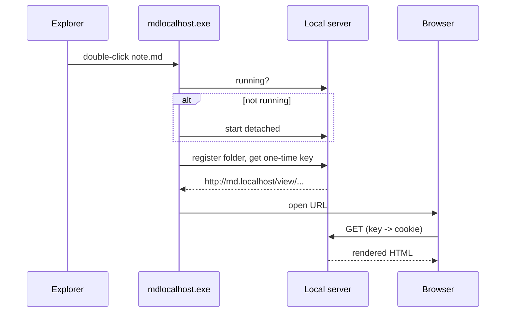

# It works

If you are reading this in your browser after double-clicking a file, the
install is done.

## Things to try

- [ ] Edit this file in your editor and save it — the page updates in place
- [ ] Click the sun/moon button, top right, to cycle light / dark / auto
- [ ] Hover a code block and use the **Copy** button
- [ ] Press the printer button to save the page as a PDF

## Code

```typescript
export function greet(name: string): string {
  return `hello, ${name}`;
}
```

## A diagram



## A table

| Shortcut | Does |
| --- | --- |
| `mdlocalhost home` | List recently viewed files |
| `mdlocalhost status` | Show the port in use |
| `mdlocalhost stop` | Shut the server down |

> Anything you link relatively — images, other Markdown files — resolves
> against this file's real folder.
